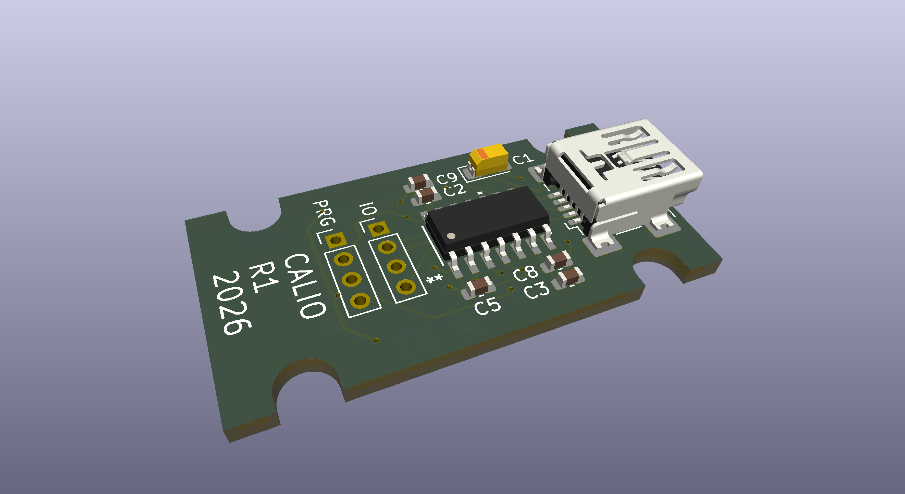
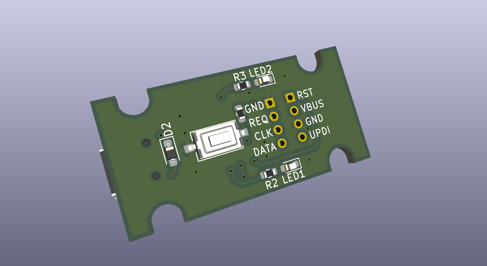
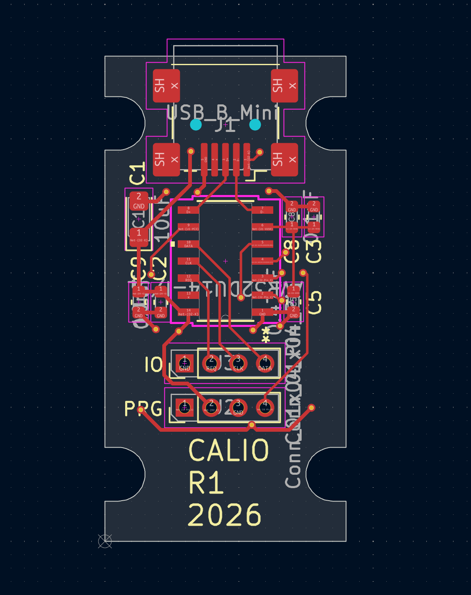
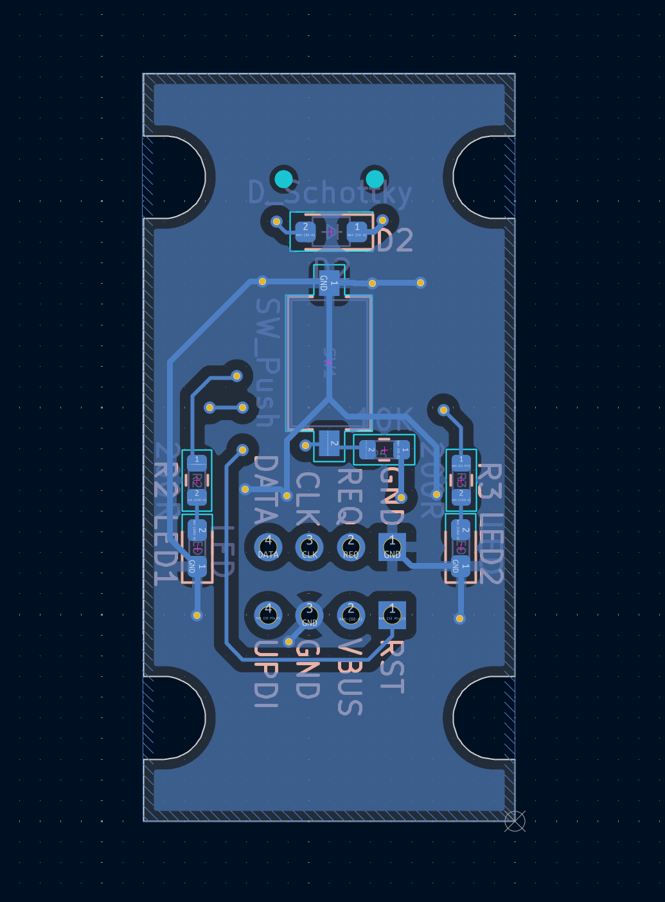
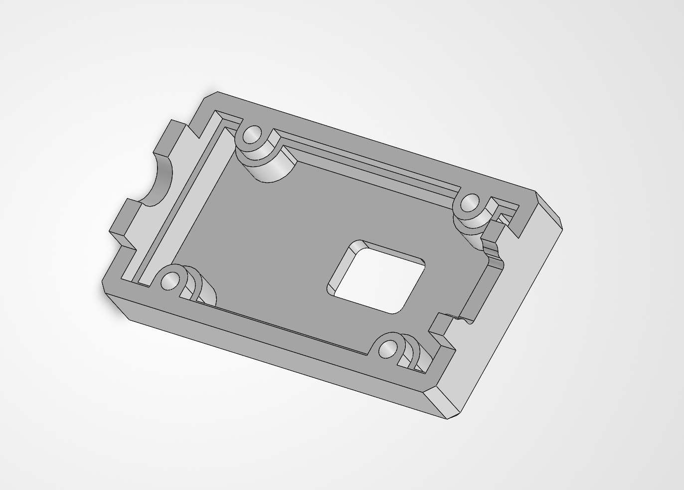
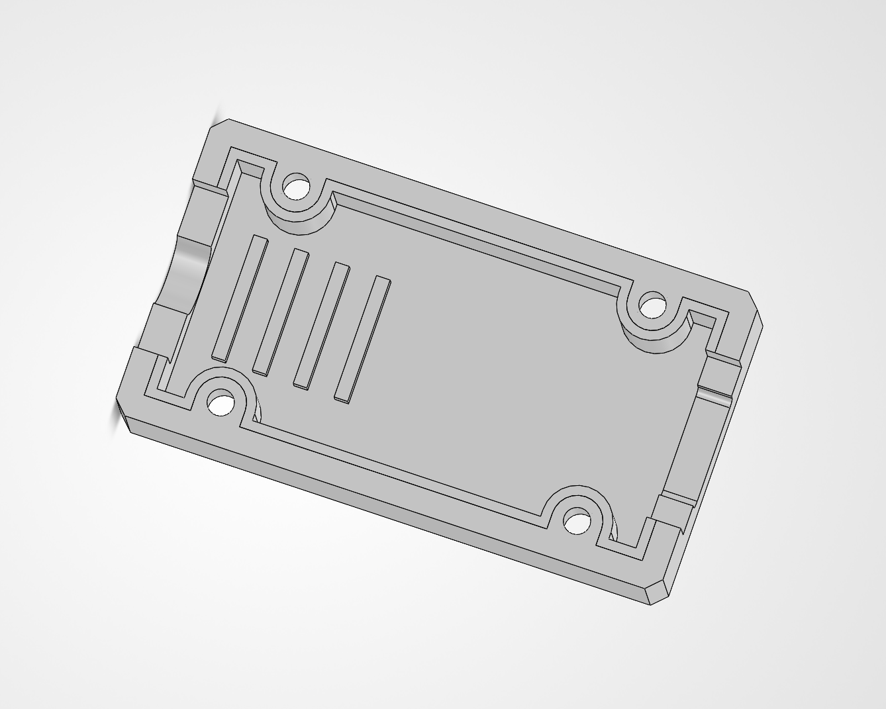
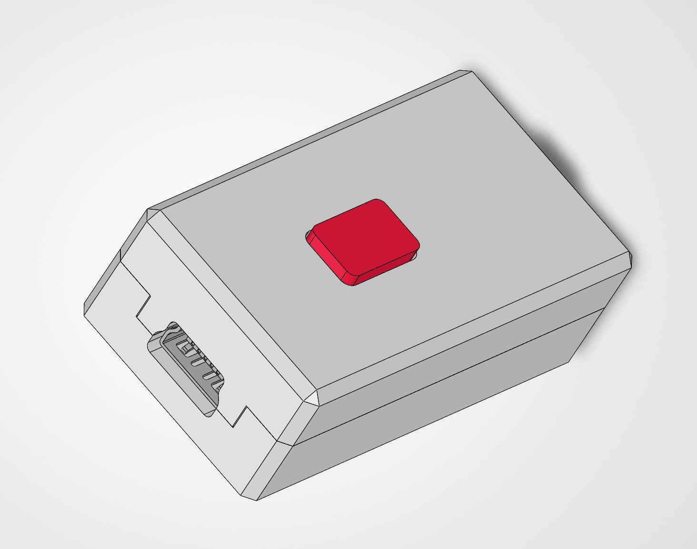

# avr32du14-usb-caliper-tool
Tools that connects to caliper port to provide USB connectivity.

Q. What does it do? 
A. You plug it in to your caliper, measure something and press the button, the value is sent to the USB Host as though it was typed by a keyboard. 

The initial PCB run is being made base on the current kicad/avr32du14/production/avr32du14.zip
The enclosure was 3d printed in PLA using a 0.2mm nozzle. It is unlikely to print with 0.4 nozzles without additional work as the wall thicknesses are so thin.
Firmware has not be written but should be fairly trivial as it is simply a USB HID keyboard interface along with some additional code to obtain the values from the caliper.
This is very much a work in progress but I needed somewhere to stash the project.

<table>
  <tr>
    <td> </td>
    <td> </td>
  </tr>
  <tr>
    <td> </td>
    <td> </td>
  </tr>
  <tr>
    <td> </td>
    <td> </td>
  </tr>
  <tr>
    <td> </td>
  </tr>
</table>
